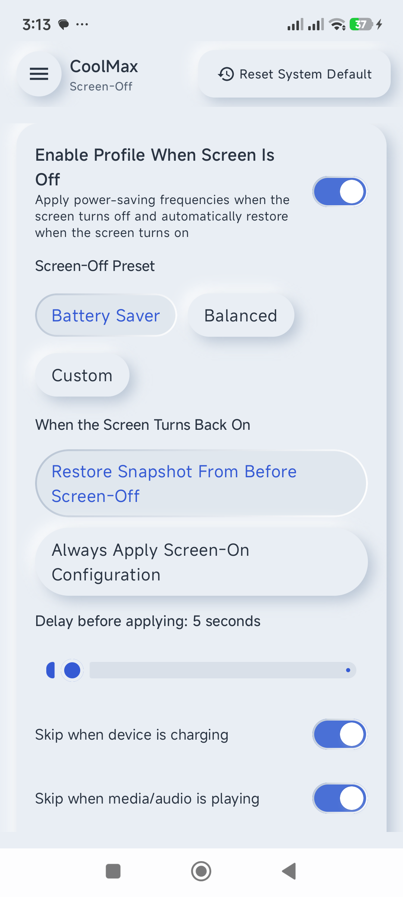
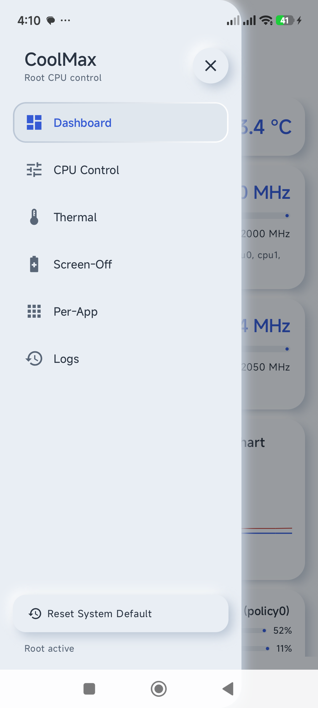

# CoolMax — Android CPU/Kernel Manager Berbasis Root dengan Screen-Off Profile Guard

**CoolMax** adalah aplikasi Android *kernel/CPU manager* berbasis **Kotlin**, **Jetpack Compose (Material 3)**, **MVVM + Repository**, **Jetpack DataStore**, dan **`libsu`** (`com.github.topjohnwu.libsu`). Pembeda utamanya adalah **Profil Layar Mati (Screen-Off Profile)** otomatis dengan arsitektur *fail-safe* berlapis untuk mencegah *bootloop*, konflik *thermal throttling*, penulisan sysfs yang ditimpa vendor HAL, maupun *command injection*.

| Kondisi Profil Layar Mati | Menu Samping (Sidebar) |
| :---: | :---: |
|  |  |

> Tangkapan layar di atas diambil dari perangkat uji Redmi Note 10 (MediaTek Helio G95). Selengkapnya ada di `test-results/`.

## Ringkasan Fitur

- **6 tab navigasi** (sidebar *drawer*, neumorphic): **Dashboard**, **CPU Control**, **Thermal**, **Screen-Off**, **Per-App**, **Logs**.
- **Profil Layar Mati otomatis**: preset *Hemat Baterai / Seimbang / Custom*, delay *apply* 0–60 detik, pengecualian *charging* & *media playback*, pemulihan *snapshot* saat layar menyala.
- **Mode Jaringan 2G saat layar mati** (opsional) dengan pemulihan mode default dan *self-heal* nilai 2G yang tertinggal.
- **Freeze aplikasi saat layar mati** (opsional) via freezer cgroup / `SIGSTOP`, plus *whitelist* aplikasi.
- **Thermal Guard global**: batas suhu manual (default **70 °C**, rentang 40–95 °C) dengan *step-down/step-up* bertahap dan histeresis.
- **Trigger otomatis**: baterai lemah, jadwal malam, dan profil **per-aplikasi** via `UsageStatsManager` resmi (termasuk pemilihan governor per aplikasi).
- **Manajemen profil** (simpan, duplikat, ekspor/impor JSON, hapus), **Undo**, **Reset Default Sistem** (di sidebar), serta **event log lokal** yang bisa diekspor dan dibersihkan.
- **Quick Settings Tile** dan **widget homescreen** untuk toggle profil layar mati dan mengganti preset tanpa membuka aplikasi.
- **Mode Simulasi (Dry-Run)** untuk mencoba alur tanpa benar-benar menyentuh `/sys`.
- **Dwibahasa**: Bahasa Indonesia (default) & Inggris; tema terang/gelap neumorphic.
- **Privasi**: **tanpa `android.permission.INTERNET`**, tanpa *analytics*/*telemetry*, semua data & log tersimpan lokal.

| Parameter Proyek | Spesifikasi |
| :--- | :--- |
| **Package / Namespace** | `id.coolmax.app` (debug: `id.coolmax.app.debug`) |
| **Versi** | `versionCode = 1`, `versionName = 1.0.0` |
| **Bahasa & Build System** | Kotlin 2.0.20 + AGP 8.5.2, Gradle Kotlin DSL (`build.gradle.kts`, Version Catalog `gradle/libs.versions.toml`) |
| **SDK Target** | `minSdk = 26` (Android 8.0), `targetSdk = 34` (Android 14), `compileSdk = 34`, Java/Kotlin JVM target 17 |
| **UI Framework** | Jetpack Compose + Material 3, Navigation Compose, Dynamic Color dimatikan (identitas neumorphic), locale ID/EN |
| **Arsitektur & State** | MVVM (`CoolMaxViewModel`) + `CpuRepository` + Coroutines / `StateFlow` + `Jetpack DataStore` |
| **Akses Root** | `com.github.topjohnwu.libsu:core:6.0.0` (tidak pernah memakai `Runtime.exec("su")` manual) |
| **Jaminan Rilis** | R8 (`isMinifyEnabled` + `isShrinkResources`) pada build rilis, `lint { abortOnError = true }` |

## 1. Struktur Modul & Daftar File Proyek

```text
CoolMax/
├── build.gradle.kts
├── settings.gradle.kts
├── gradle.properties
├── gradlew / gradlew.bat
├── keystore.properties.example      # contoh kredensial signing rilis (file asli di-gitignore)
├── gradle/
│   ├── libs.versions.toml
│   └── wrapper/gradle-wrapper.properties
├── README.md
├── changes.md                       # catatan audit antislop & daftar perubahan
├── perubahan.md                     # log pengujian runtime di perangkat + rekomendasi
├── test-results/                    # bukti pengujian perangkat (PNG + device-test-report.md)
└── app/
    ├── build.gradle.kts
    ├── proguard-rules.pro
    └── src/
        ├── main/
        │   ├── AndroidManifest.xml
        │   ├── java/id/coolmax/app/
        │   │   ├── CoolMaxApplication.kt
        │   │   ├── MainActivity.kt
        │   │   ├── data/
        │   │   │   ├── freeze/AppFreezer.kt
        │   │   │   ├── network/NetworkModeController.kt
        │   │   │   ├── packages/InstalledAppRepository.kt
        │   │   │   ├── preferences/CoolMaxPreferences.kt
        │   │   │   ├── repository/CpuRepository.kt
        │   │   │   ├── root/
        │   │   │   │   ├── RootManager.kt
        │   │   │   │   └── SocVendor.kt
        │   │   │   └── sysfs/
        │   │   │       ├── SysfsReader.kt
        │   │   │       └── SysfsWriter.kt
        │   │   ├── domain/
        │   │   │   ├── model/CpuModels.kt
        │   │   │   ├── profile/ProfileJsonValidator.kt
        │   │   │   ├── safety/SafeFrequencyPlanner.kt
        │   │   │   ├── sysfs/SysfsParser.kt
        │   │   │   ├── thermal/ThermalThrottlePlanner.kt
        │   │   │   └── trigger/
        │   │   │       ├── GovernorPriorityResolver.kt
        │   │   │       └── TriggerPriorityResolver.kt
        │   │   ├── service/
        │   │   │   ├── BootCompletedReceiver.kt
        │   │   │   ├── CoolMaxWidgetProvider.kt
        │   │   │   ├── ForegroundAppDetector.kt
        │   │   │   ├── ScreenOffGuardService.kt
        │   │   │   └── ScreenOffTileService.kt
        │   │   ├── ui/
        │   │   │   ├── CoolMaxViewModel.kt
        │   │   │   ├── components/
        │   │   │   │   ├── GovernorDropdown.kt
        │   │   │   │   └── Neu.kt
        │   │   │   ├── screens/
        │   │   │   │   ├── CpuControlScreen.kt
        │   │   │   │   ├── DashboardScreen.kt
        │   │   │   │   ├── LogScreen.kt
        │   │   │   │   ├── PerAppScreen.kt
        │   │   │   │   ├── RootRequiredScreen.kt
        │   │   │   │   ├── ScreenOffScreen.kt
        │   │   │   │   └── ThermalScreen.kt
        │   │   │   └── theme/
        │   │   │       ├── Color.kt
        │   │   │       └── Theme.kt
        │   │   └── util/FreqFormatters.kt
        │   └── res/
        │       ├── drawable/ (ikon aplikasi, background & tombol widget)
        │       ├── drawable-night/ (varian widget tema gelap)
        │       ├── layout/widget_coolmax.xml
        │       ├── mipmap-anydpi-v26/ (adaptive icon)
        │       ├── values/ (strings.xml Bahasa Indonesia - default, colors, themes)
        │       ├── values-in/strings.xml (Bahasa Indonesia)
        │       ├── values-en/strings.xml (English)
        │       ├── values-night/ (colors, themes)
        │       └── xml/coolmax_widget_info.xml
        └── test/java/id/coolmax/app/
            ├── data/freeze/AppFreezerTest.kt
            ├── data/network/NetworkModeControllerTest.kt
            ├── data/sysfs/MtkOppFallbackWriterTest.kt
            ├── data/sysfs/SysfsWriterTest.kt
            ├── domain/profile/ProfileJsonValidatorTest.kt
            ├── domain/safety/SafeFrequencyPlannerTest.kt
            ├── domain/sysfs/SysfsParserTest.kt
            ├── domain/thermal/ThermalThrottlePlannerTest.kt
            ├── domain/trigger/GovernorPriorityResolverTest.kt
            └── domain/trigger/TriggerPriorityResolverTest.kt
```

## 2. Cara Build & Menjalankan Unit Test

Prasyarat: **JDK 17** dan **Android SDK** dengan **Platform 34** serta *build-tools* yang sesuai. Pastikan `ANDROID_HOME` atau `sdk.dir` di `local.properties` menunjuk ke instalasi SDK Anda (contoh: `sdk.dir=C\:\\path\\to\\android-sdk`). Proyek bisa dibuka langsung di **Android Studio Ladybug (2024.2.1)+** atau dibangun lewat terminal di root proyek:

```bash
# Unit test JUnit 4 (10 kelas: AppFreezer, NetworkModeController, MtkOppFallbackWriter,
# SysfsWriter, ProfileJsonValidator, SafeFrequencyPlanner, SysfsParser, ThermalThrottlePlanner,
# GovernorPriorityResolver, TriggerPriorityResolver)
./gradlew test

# Debug APK -> app/build/outputs/apk/debug/app-debug.apk (applicationId id.coolmax.app.debug)
./gradlew assembleDebug

# Lint (build rilis gagal bila ada error lint)
./gradlew lint

# Release APK -> app/build/outputs/apk/release/app-release.apk (R8 minify + shrinkResources)
./gradlew assembleRelease
```

### Signing rilis

Kredensial *release* dibaca dari `keystore.properties` di root proyek (file itu **di-gitignore**, begitu juga `*.jks`/`*.keystore`). Salin contohnya lebih dulu:

```bash
cp keystore.properties.example keystore.properties
# lalu isi storeFile / storePassword / keyAlias / keyPassword
```

Tanpa file tersebut, build rilis tetap berjalan tetapi **tidak ditandatangani** — tidak ada jalur keystore atau kata sandi yang di-*hardcode* di repositori.

## 3. Cara Kerja Fitur Utama: Profil Layar Mati (Screen-Off Profile)

1. **Pendaftaran BroadcastReceiver Dinamis di Foreground Service**:
   - Android 8.0+ (API 26+) melarang pendaftaran implisit `ACTION_SCREEN_OFF` dan `ACTION_SCREEN_ON` di `AndroidManifest.xml`.
   - Ketika pengguna mengaktifkan toggle **"Aktifkan Profil Saat Layar Mati"** (default: `OFF`), aplikasi menjalankan `ScreenOffGuardService` sebagai *Foreground Service* (`foregroundServiceType="specialUse"`) dengan notifikasi persisten berprioritas rendah.
   - Di dalam `ScreenOffGuardService.onCreate()`, `BroadcastReceiver` untuk `Intent.ACTION_SCREEN_OFF` dan `Intent.ACTION_SCREEN_ON` didaftarkan secara dinamis (`registerReceiver`) dan dilepas (`unregisterReceiver`) saat `onDestroy()`.
2. **Alur Saat Layar Mati (`ACTION_SCREEN_OFF`)**:
   - Service membatalkan *job* tertunda sebelumnya dan memeriksa apakah **Safe Mode** sedang aktif atau apakah fitur sedang dijeda (*Pause 1 Jam*).
   - Menjalankan *delay coroutine* sesuai preferensi pengguna (**0–60 detik**, default **5 detik**) untuk menghindari penerapan berulang saat layar hanya mati sejenak.
   - Setelah *delay* selesai, service memverifikasi ulang bahwa layar benar-benar masih mati (`!PowerManager.isInteractive`).
   - Memeriksa **Pengecualian (Exclusions)**:
     - Jika opsi *"Jangan terapkan saat mengisi daya"* aktif dan `BatteryManager.isCharging == true`, profil layar mati dilewati.
     - Jika opsi *"Jangan terapkan saat media/musik diputar"* aktif dan `AudioManager.isMusicActive == true`, profil layar mati dilewati.
   - Menyimpan *snapshot* konfigurasi *screen-on* saat ini ke `CoolMaxPreferences` (`DataStore`) agar dapat dipulihkan secara presisi.
   - Menerapkan konfigurasi *Screen-Off* per cluster (Preset **Hemat Baterai**, **Seimbang**, atau **Custom** termasuk opsi menonaktifkan core non-`cpu0` tertentu).
3. **Alur Saat Layar Menyala (`ACTION_SCREEN_ON`)**:
   - Service langsung membatalkan *coroutine delay* `screenOffDelayJob` jika masih menghitung mundur.
   - Memulihkan profil *screen-on* sesuai mode yang dipilih: **Restore Snapshot Sebelum Layar Mati** (default) atau **Selalu Terapkan Konfigurasi Screen-On** tersimpan, memakai urutan penulisan sysfs yang aman.
4. **Pemulihan Setelah Reboot (`BOOT_COMPLETED`)**:
   - `BootCompletedReceiver` menangkap `android.intent.action.BOOT_COMPLETED` (dan `QUICKBOOT_POWERON`).
   - Memeriksa flag `pending_apply`: jika masih `true` dari sesi sebelum reboot, aplikasi masuk ke **Safe Mode** dan tidak menerapkan profil apa pun.
   - Jika aman dan toggle Screen-Off aktif, receiver menunggu **delay wajib 60 detik** setelah `BOOT_COMPLETED` sebelum menyalakan kembali `ScreenOffGuardService`.
   - `CoolMaxApplication.onCreate()` juga menyalakan kembali service bila ada fitur guard yang aktif, sehingga profil tidak berhenti diam-diam setelah aplikasi di-*update*.
5. **Mode Jaringan 2G Saat Layar Mati (`network2gOnScreenOff`)**:
   - Toggle terpisah di tab **Layar Mati** (default `OFF`). Jika aktif dan profil layar mati benar-benar diterapkan (setelah *delay* dan lolos pengecualian *charging*/*media*), `NetworkModeController` memaksa seluruh entri `settings global` `preferred_network_mode*` dan `user_preferred_network_mode*` menjadi `1` (**GSM only / 2G**) lalu menyimpan nilai sebelumnya ke DataStore (`network_mode_baseline_json`).
   - RIL hanya membaca ulang nilai tersebut saat radio menyala, sehingga setiap perubahan diikuti siklus *airplane mode* singkat (~2 detik) yang **selalu diakhiri dengan airplane mode OFF**, termasuk bila perintah gagal atau *timeout*. Siklus dilewati bila pengguna memang sudah mengaktifkan airplane mode.
   - Saat layar menyala, nilai sebelumnya ditulis kembali (key yang semula tidak ada akan dihapus) dan radio di-refresh dengan cara yang sama; event dicatat terpisah sebagai `SCREEN_ON | Screen-On Network Restore`.
   - *Fail-safe* berlapis: (a) nilai 2G **tidak pernah** dipakai sebagai *baseline* saat proses *capture*, (b) `restoreDefault` menjalankan `healStaleGsmOnly` untuk mereset entri/slot yang masih terkunci GSM, (c) cermin *baseline* di `settings global`, nilai cadangan `GSM|UMTS|LTE`, *watchdog* saat layar menyala, dan flag `network_radio_refresh_pending` / `network_mode_2g_active` memulihkan mode default saat aplikasi start bila proses sebelumnya terhenti (termasuk bila service dibunuh sistem saat layar mati).
6. **Freeze Aplikasi Saat Layar Mati (`freezeAppsOnScreenOff` + whitelist)**:
   - Toggle terpisah di tab **Layar Mati** (default `OFF`). Saat profil layar mati benar-benar diterapkan, `AppFreezer` membekukan (`freeze`, bukan `force-stop`, sehingga state aplikasi tidak hilang) semua aplikasi pihak ketiga yang sedang berjalan, kecuali paket di whitelist.
   - Mekanisme: freezer cgroup per-UID (`/sys/fs/cgroup/uid_<uid>/cgroup.freeze`, lalu `…/freezer/uid_<uid>/freezer.state`, lalu `/dev/freezer/…`), dengan *fallback* `SIGSTOP` per PID yang dilepas kembali memakai `SIGCONT` saat layar menyala.
   - Hanya UID aplikasi (10000–19999) yang seluruh paketnya non-sistem yang disentuh. CoolMax sendiri, launcher (HOME) dan input method **selalu** dikecualikan, sehingga ROM/system tidak pernah dibekukan.
   - Daftar UID sasaran disimpan ke DataStore **sebelum** proses freeze, lalu di-thaw pada setiap screen-on, start service, buka aplikasi, dan aksi *Pause 1 Hour*/*Reset Default*. Freeze yang gagal separuh langsung di-rollback.
   - Whitelist dipilih lewat dialog pencarian aplikasi (hanya aplikasi yang punya launcher), dan entri untuk aplikasi yang sudah di-uninstall otomatis dibersihkan.
7. **Akses cepat dari luar aplikasi**:
   - **Quick Settings Tile** (`ScreenOffTileService`) untuk menyalakan/mematikan profil layar mati dari panel pengaturan cepat.
   - **Widget homescreen** (`CoolMaxWidgetProvider`, layout `widget_coolmax.xml`, varian terang & gelap) menampilkan status profil aktif dengan tombol satu-tekan untuk toggle Screen-Off dan mengganti preset.

## 4. Thermal Guard, Per-App Governor, Profil & Event Log

- **Thermal Guard global** (`ThermalThrottlePlanner`, tab **Thermal**): batas suhu manual default **70 °C** (rentang yang diizinkan **40–95 °C**, peringatan "berisiko" di atas **85 °C**). Saat suhu melewati batas, ceiling `scaling_max_freq` tiap cluster diturunkan **satu langkah frekuensi** dan tidak pernah di bawah lantai aman **30 %** dari `cpuinfo_max_freq`; kenaikan kembali hanya terjadi di bawah `batas - histeresis` (**4 °C**). Polling **4 detik** saat layar menyala dan **15 detik** saat layar mati. Thermal guard berada di atas semua profil lain karena hanya menurunkan `scaling_max_freq`.
- **Profil per-aplikasi** (`InstalledAppRepository`, `ForegroundAppDetector`, `GovernorPriorityResolver`): memakai `UsageStatsManager` resmi (`PACKAGE_USAGE_STATS`) untuk mendeteksi aplikasi *foreground*, lalu menerapkan governor khusus per aplikasi. Daftar aplikasi dibaca lewat `queryIntentActivities(ACTION_MAIN + CATEGORY_LAUNCHER)` dengan blok `<queries>` di manifest, sehingga **tidak** memerlukan `QUERY_ALL_PACKAGES`. Prioritas governor: **Screen-Off Profile > Per-App Governor > Governor global**, dengan *debounce* agar governor yang sama tidak ditulis ulang.
- **Manajemen profil** (`ProfileJsonValidator`): simpan konfigurasi saat ini sebagai profil bernama, duplikat, ekspor/impor JSON (divalidasi ketat sebelum dipakai), dan hapus.
- **Event log lokal** (tab **Logs**): riwayat event (trigger, apply, override vendor, restore jaringan, thermal) dengan aksi ekspor dan bersihkan; tidak ada satu byte pun yang dikirim ke jaringan.

## 5. Arsitektur Keamanan (Safety-First Design)

| Lapisan Keamanan | Implementasi Teknis di CoolMax |
| :--- | :--- |
| **1. Fail-Safe by Default** | Seluruh toggle otomatis (`ScreenOffSettings.enabled`, `batteryTriggerEnabled`, `scheduleTriggerEnabled`, `perAppTriggerEnabled`, `network2gOnScreenOff`, `freezeAppsOnScreenOff`) bernilai default `false`. |
| **2. Batas Bawah Frekuensi 30 % & Peringatan 50 %** | `SafeFrequencyPlanner` menolak keras `scaling_max_freq < 30 %` dari `cpuinfo_max_freq` cluster dan menampilkan peringatan UI apabila `< 50 %`. |
| **3. Perlindungan Core (`cpu0` & Cluster Online)** | `SafeFrequencyPlanner` dan `SysfsWriter` melarang keras penulisan `0` ke `/sys/devices/system/cpu/cpu0/online` serta mewajibkan minimal **1 core tetap online** di setiap cluster. |
| **4. Urutan Penulisan Aman (`Min/Max Ordering`)** | Saat menaikkan frekuensi (`target.max >= current.max`), `scaling_max_freq` ditulis **lebih dulu** baru `scaling_min_freq`. Saat menurunkan frekuensi (`target.max < current.max`), `scaling_min_freq` diturunkan **lebih dulu** baru `scaling_max_freq` agar kernel tidak menolak dengan `EINVAL`. |
| **5. Perlindungan Bootloop (`pending_apply` + 60s Boot Delay)** | Sebelum menulis ke sysfs, `pending_apply = true` disimpan di `DataStore`. Flag baru dihapus setelah *read-back verification* berhasil dan sistem berjalan stabil selama **2 menit**. Jika perangkat *crash*/*reboot* saat flag masih `true`, startup berikutnya otomatis mengaktifkan **Safe Mode**, mematikan semua *auto-apply*, dan memulihkan *snapshot* awal. Tidak ada skrip yang dipasang di `/system`, `/vendor`, atau `init.d`. |
| **6. Snapshot, Undo & Konfirmasi 15 Detik** | Saat pertama kali dijalankan (*first-run*), nilai asli kernel disimpan ke `DataStore`. Setiap perubahan manual menampilkan dialog hitung mundur **15 detik**; jika pengguna tidak menekan **"Pertahankan"**, nilai otomatis dikembalikan (*auto-revert*). Tombol **Undo**, **Expor/Impor profil**, dan **Reset Default Sistem** (sidebar) selalu tersedia. |
| **7. Thermal Guard Bertahap** | Batas suhu default **70 °C** (40–95 °C). Bukan sekadar *rollback*: `ThermalThrottlePlanner` menurunkan satu langkah frekuensi per tick, menjaga lantai **30 %**, dan memakai histeresis **4 °C** sebelum menaikkan kembali; episode termal dapat dipulihkan (RESTORE) tanpa mematikan profil pengguna. |
| **8. Penulisan Sysfs Terpusat & Anti-Injection** | Hanya kelas `SysfsWriter` yang menulis ke `/sys`. Semua path divalidasi dengan regex `^/sys/devices/system/cpu/[a-zA-Z0-9_/.-]+$` (tanpa `..`) dan nilai divalidasi dengan `^[a-zA-Z0-9_-]{1,32}$`. Dilengkapi *timeout* **3 detik**, *retry* maksimal **1×**, *read-back verification*, serta opsi **Mode Simulasi (Dry-Run)**. |
| **9. Fallback Sadar-SoC** | `SocVendor.detect()` mengklasifikasikan perangkat (dari `Build.SOC_MANUFACTURER`, `Build.HARDWARE`, `Build.BOARD`). **MediaTek**: bila `scaling_max_freq` di-*clamp*, `MtkOppFallbackWriter` menulis indeks OPP terdekat ke `/proc/cpufreq/MT_CPU_DVFS_*/cpufreq_oppidx` lalu memverifikasi hasil bacanya. **Qualcomm**: urutan `scaling_min_freq` → `scaling_max_freq` dengan netralisasi, dan clamp yang menetap dilaporkan apa adanya ke pengguna. |
| **10. Privasi Tanpa Jaringan** | Manifest tidak mendeklarasikan `android.permission.INTERNET`; tidak ada SDK analitik/iklan; seluruh preferensi, profil, snapshot, dan log hanya ada di DataStore lokal. |

## 6. Hierarki Prioritas Trigger Otomatis

Seluruh evaluasi trigger dikelola oleh `TriggerPriorityResolver` dengan urutan prioritas mutlak dari tertinggi ke terendah:

1. **`SAFE_MODE` (Prioritas 100)**: Aktif jika terdeteksi kegagalan *apply* sebelumnya (`pending_apply`). Mematikan semua trigger lain dan memulihkan default sistem.
2. **`HIGH_TEMPERATURE` (Prioritas 90)**: Aktif jika suhu CPU melampaui batas aman termal yang dikonfigurasi. Membatalkan profil performa dan memulihkan default sistem.
3. **`MANUAL` (Prioritas 80)**: Konfigurasi manual yang diterapkan dan dikonfirmasi pengguna saat layar menyala.
4. **`PER_APP` (Prioritas 70)**: Profil khusus aplikasi foreground yang dideteksi menggunakan API resmi `UsageStatsManager` (`PACKAGE_USAGE_STATS`).
5. **`SCREEN_OFF` (Prioritas 60)**: Profil hemat daya saat layar mati (setelah melewati *delay* 0–60 detik dan lolos pemeriksaan pengecualian *charging* & *media playback*).
6. **`BATTERY_LOW` (Prioritas 55)**: Profil hemat daya otomatis saat baterai `<= X%` (default `20%`) atau saat mengisi daya (opsional).
7. **`SCHEDULE` (Prioritas 50)**: Jadwal waktu otomatis (default `23:00–06:00`), mendukung rentang waktu lintas tengah malam.
8. **`SYSTEM_DEFAULT` (Prioritas 10)**: Nilai dasar standar perangkat.

Untuk lapisan governor berlaku urutan terpisah (`GovernorPriorityResolver`): **Screen-Off Profile > Per-App Governor > Governor global**, sementara Thermal Guard selalu berada di atas semuanya.

## 7. Daftar Path Sysfs yang Digunakan

Semua path ditemukan secara dinamis tanpa *hardcode* nomor cluster atau asumsi SoC tertentu:

| Path Sysfs | Mode | Fungsi & Fallback |
| :--- | :--- | :--- |
| `/sys/devices/system/cpu/cpufreq/policy*/` | Baca | Path utama deteksi cluster CPU (mis. `policy0`, `policy4`, `policy7`). |
| `/sys/devices/system/cpu/cpu*/cpufreq/` | Baca | **Fallback otomatis** jika direktori `cpufreq/policy*` tidak tersedia di kernel lama. |
| `.../related_cpus` & `.../affected_cpus` | Baca | Daftar core yang berada di dalam satu cluster policy. |
| `.../scaling_cur_freq` (fallback `cpuinfo_cur_freq`) | Baca | Frekuensi real-time cluster saat ini (dalam kHz). |
| `.../scaling_min_freq` & `.../scaling_max_freq` | Baca / Tulis | Batas frekuensi minimum dan maksimum aktif (dalam kHz). |
| `.../cpuinfo_min_freq` & `.../cpuinfo_max_freq` | Baca | Batas frekuensi perangkat keras cluster untuk validasi batas aman 30 % / 50 %. |
| `.../scaling_available_frequencies` | Baca | Daftar langkah frekuensi yang didukung oleh cluster. |
| `.../stats/time_in_state` | Baca | Statistik waktu per frekuensi (10 ms jiffies) sekaligus **fallback otomatis** jika `scaling_available_frequencies` tidak ada. |
| `.../scaling_governor` | Baca / Tulis | Governor CPU yang sedang aktif pada cluster. |
| `.../scaling_available_governors` | Baca | Daftar governor yang didukung oleh kernel pada cluster tersebut. |
| `/sys/devices/system/cpu/online` & `.../cpuX/online` | Baca / Tulis | Status online/offline core (`cpu0` dikunci selalu online). |
| `/sys/class/thermal/thermal_zone*/type` & `.../temp` | Baca | Sensor suhu CPU/SoC (otomatis mengonversi miliderajat Celcius ke `°C`). |
| `/proc/cpufreq/MT_CPU_DVFS_*/cpufreq_oppidx` | Baca / Tulis | **Fallback MediaTek**: indeks OPP terdekat bila `scaling_max_freq` di-*clamp* oleh PPM/thermal driver. Nama node divalidasi dengan regex `^MT_CPU_DVFS_[A-Z]+$`. |
| `/sys/fs/cgroup/uid_<uid>/cgroup.freeze`, `…/freezer/uid_<uid>/freezer.state`, `/dev/freezer/…` | Tulis | **Freeze aplikasi** per UID saat layar mati (dengan *fallback* `SIGSTOP`/`SIGCONT`). |

## 8. Asumsi Teknis & Keterbatasan Perangkat Nyata

1. **Vendor Power HAL / Perfd / Thermal Engine Override**:
   - Pada beberapa perangkat modern (Qualcomm Snapdragon dengan `qti-perfd`/`perfhal`, MediaTek PPM + `mtkts*` thermal zone, atau Google Tensor), *daemon* vendor dapat menimpa kembali `scaling_min_freq` / `scaling_max_freq` beberapa milidetik setelah ditulis.
   - Sesuai prinsip keamanan, CoolMax **tidak mematikan atau melawan thermal daemon sistem**. Sebagai gantinya, `SysfsWriter` melakukan `chmod 0644` + *read-back verification*, mencoba fallback sadar-SoC (lihat lapisan keamanan #9), dan memberi tahu pengguna secara transparan apabila nilai tetap ditimpa oleh *vendor HAL* atau *thermal throttling*.
2. **Kebijakan SELinux (`Enforcing`)**:
   - CoolMax hanya membaca status SELinux (`getenforce`) dan **tidak pernah mengubah SELinux menjadi Permissive** (`setenforce 0` tidak pernah dijalankan) demi menjaga integritas keamanan perangkat. Seluruh pembacaan/penulisan sysfs dijalankan melalui konteks root shell `libsu` (`Shell.FLAG_MOUNT_MASTER`), dan kegagalan baca (misalnya sensor termal yang terblokir SELinux) ditampilkan sebagai "sensor tidak tersedia", bukan disembunyikan.
3. **Klasifikasi Tier Cluster Dinamis**:
   - Karena kernel Linux tidak menyediakan label teks `"little"`, `"big"`, atau `"prime"` secara seragam, `SysfsParser.classifyClusterTiers()` mengurutkan cluster berdasarkan `cpuinfo_max_freq`: 2 cluster diklasifikasikan sebagai `LITTLE` dan `BIG`; 3+ cluster sebagai `LITTLE`, `BIG`, dan `PRIME`.
4. **Perubahan Mode Jaringan Bergantung pada RIL Vendor**:
   - Aplikasi pihak ketiga tidak dapat memanggil `TelephonyManager.setAllowedNetworkTypesForReason()` (butuh izin sistem), sehingga CoolMax menulis entri `settings global` yang dipakai framework telephony dan me-refresh radio lewat siklus airplane mode singkat.
   - Pada sebagian perangkat/ROM, perubahan baru benar-benar terlihat di modem setelah registrasi jaringan berikutnya; event log menampilkan key yang berhasil ditulis dan key yang masih tertahan agar pengguna dapat memverifikasinya. Pemulihan instan hanya berjalan selama proses aplikasi terjaga; watchdog mencoba memulihkan sekali per menit saat layar menyala.
5. **Pembekuan Aplikasi Bergantung pada Kernel**:
   - Tersedianya freezer cgroup berbeda-beda antar kernel/ROM. Jika cgroup tidak tersedia, mekanisme turun ke `SIGSTOP` per PID; aplikasi yang tidak dapat dibekukan tetap berjalan dan dicatat di log, bukan dipaksa `force-stop`.
6. **Kredensial Signing Tidak Ada di Repositori**:
   - `keystore.properties`, `*.jks`, dan `*.keystore` di-gitignore. Build rilis tanpa file tersebut akan menghasilkan APK tidak tertandatangani.

## 9. Dokumentasi Pendukung

| Dokumen | Isi |
| :--- | :--- |
| `changes.md` | Catatan audit antislop (R-01–R-38), perbaikan kontras WCAG AA, aksesibilitas fokus/tap target, dan perbaikan bug jaringan 2G saat layar mati. |
| `perubahan.md` | Log pengujian runtime di perangkat (MediaTek MT6785 / Redmi Note 10), temuan clamp MediaTek, dan desain fallback OPP. |
| `test-results/device-test-report.md` | Laporan pengujian di perangkat + tangkapan layar (`device-dashboard.png`, `device-screenoff.png`, `device-sidebar.png`, dll.). |

## 10. Riwayat Versi

- **1.0.0** — Rilis pertama: 6 tab UI neumorphic, profil layar mati (`fail-safe` berlapis), mode 2G saat layar mati, freeze aplikasi + whitelist, thermal guard bertahap, profil per-aplikasi via UsageStats, manajemen profil JSON, event log lokal, Quick Settings Tile, widget homescreen, fallback sadar-SoC MediaTek/Qualcomm, dan unit test untuk seluruh logika domain.
